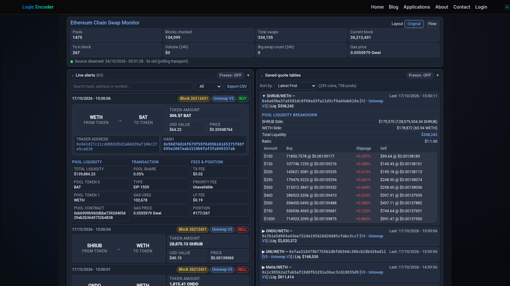

# Ethereum Swaps — WordPress Dashboard

On-chain activity becomes easier to explore when a live feed, recurring addresses and comparison views are available together. Ethereum Swaps brings those parts of the monitoring experience into a WordPress page, giving visitors a focused way to investigate the observed swap activity.

## Tech stack

| Layer | Technologies |
|---|---|
| Core stack | PHP; WordPress; JavaScript; HTML; CSS |

## Follow the swap feed

The live alert feed keeps relevant transactions in one place. Expandable entries offer more detail when a particular observation deserves attention. The goal is to help visitors move from a busy sequence of events to a transaction they want to investigate.

A browsable feed turns an ongoing stream into something a visitor can explore at their own pace. Start with a recent swap, then use the available context to decide what deserves a closer look.

## Inspect recurring participants

Address-focused panels and trader information help narrow the view to participants appearing in the observed activity. Rankings provide a starting point for exploration without assigning a motive to the address. Available transaction references support a closer check.

Address-focused views are useful when an investigation begins with a participant instead of a transaction. They provide another entry point into the same observed activity.

## Keep market comparisons nearby

Saved quote tables give visitors another perspective alongside the live feed. Time-span controls help focus the information on the period being examined. Keeping these views together reduces repeated switching during an investigation.

Comparisons place the swap information beside related market context. The visitor can examine the relationship without leaving the dashboard to reconstruct a separate view.

## Understand the current view

A health strip and configurable panels help visitors recognise the monitoring context. Collapsible charts allow the page to balance overview and detail. Updates support following activity without constantly rebuilding the selected view.

Current-state information helps distinguish the data being displayed from the conditions under which it was collected. It supports interpreting the page during a quiet period or an interruption.

## Publish the experience in WordPress

The plugin supplies the visitor-facing dashboard for the related Ethereum Chain Swap Monitor product. Site operators can place that experience within their WordPress presentation while maintaining its connection and display settings. The two products have related roles: monitoring and a published investigation workspace.

WordPress publishing lets the site owner place the experience beside related content. The plugin gives visitors a coherent interface while retaining a separate area for its administration.

---

Private code: [eth-swaps-monitor-plugin](https://github.com/logicencoder/eth-swaps-monitor-plugin)

See [REPOS.md](REPOS.md) for related repositories.

**[Logic Encoder](https://logicencoder.com)** · [GitHub](https://github.com/logicencoder) · [Contact](https://logicencoder.com/contact/)
