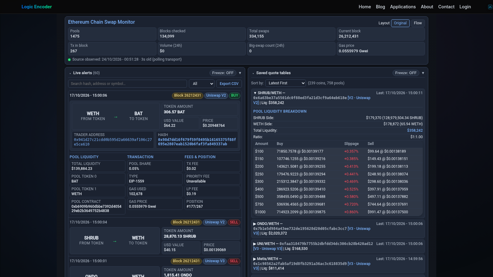

# Ethereum Swaps — WordPress Dashboard

Ethereum Swaps is the visitor-facing dashboard of the Ethereum Chain Swap Monitor, published as a WordPress page on [logicencoder.com](https://logicencoder.com). It shows the live swap feed with searchable and filterable entries, the most active addresses, saved quote tables, a map of the monitored pool routes and a log of past activity, so visitors can explore on-chain swap activity without running the monitor themselves.

## Tech stack

| Layer | Technologies |
|---|---|
| Core stack | PHP; WordPress; JavaScript; HTML; CSS |

## Follow the swap feed

The live feed lists swaps as they arrive. A search box finds a transaction hash, address or symbol, a filter shows all swaps, only buys or only sells, entries expand for detail, a freeze switch stops the list while you read, and the feed can be exported to CSV. A separate activity log lists past swaps with a refresh interval of 3, 5 or 10 seconds, or paused.

A browsable feed turns an ongoing stream into something a visitor can explore at their own pace. Start with a recent swap, then use the available context to decide what deserves a closer look.

## Inspect recurring participants

The Top addresses ranking can show the top 10, 20 or 50 participants, and an address search narrows the view to one of them. The ranking is a starting point for exploration and says nothing about motive; transaction references allow a closer check.

Address-focused views are useful when an investigation begins with a participant instead of a transaction. They provide another entry point into the same observed activity.

## Keep market comparisons nearby

Saved quote tables can be ordered latest or oldest first, by coin name (A to Z or Z to A) or by liquidity (highest or smallest), and the time-span controls focus the statistics on the period being examined.

Comparisons place the swap information beside related market context. The visitor can examine the relationship without leaving the dashboard to reconstruct a separate view.

## Understand the current view

A layout switch changes between the original panel layout and a Flow view: a 3D map of the monitored pool routes that can be orbited, panned, zoomed and shown full screen. A health strip reports the state of the feed, and panels and charts can be collapsed or resized. Updates arrive live over a WebSocket connection, and statistics are merged field by field so a partial update never blanks a value.

Current-state information helps distinguish the data being displayed from the conditions under which it was collected. It supports interpreting the page during a quiet period or an interruption.

## Publish the experience in WordPress

The plugin supplies this dashboard for the related Ethereum Chain Swap Monitor. In WordPress the administrator has a settings page with the bridge connection (live-feed address and a regenerable access key), the live feed and header statistics, behaviour such as pausing only the rendering or freezing the whole feed, comfortable or compact density, panel heights, appearance and the shortcode that places the page.

WordPress publishing lets the site owner place the experience beside related content. The plugin gives visitors a coherent interface while retaining a separate area for its administration.

---

Private code: [eth-swaps-monitor-plugin](https://github.com/logicencoder/eth-swaps-monitor-plugin)

See [REPOS.md](REPOS.md) for related repositories.

**[Logic Encoder](https://logicencoder.com)** · [GitHub](https://github.com/logicencoder) · [Contact](https://logicencoder.com/contact/)
